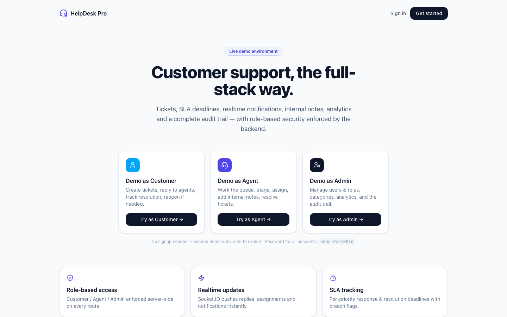
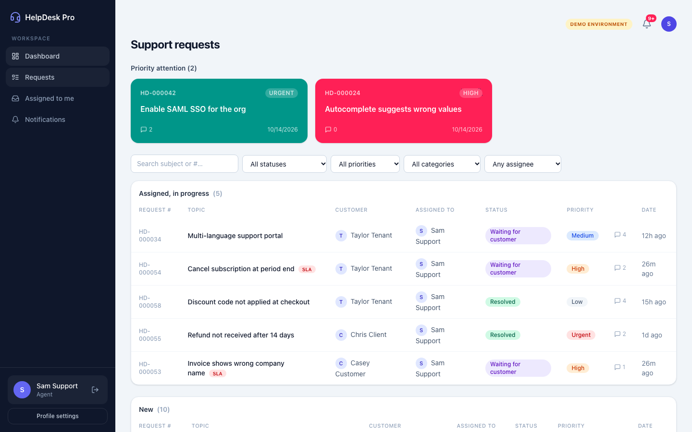
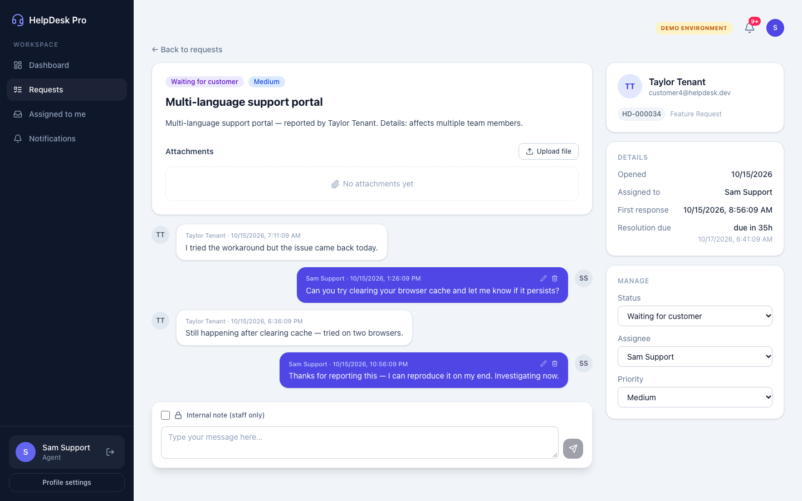
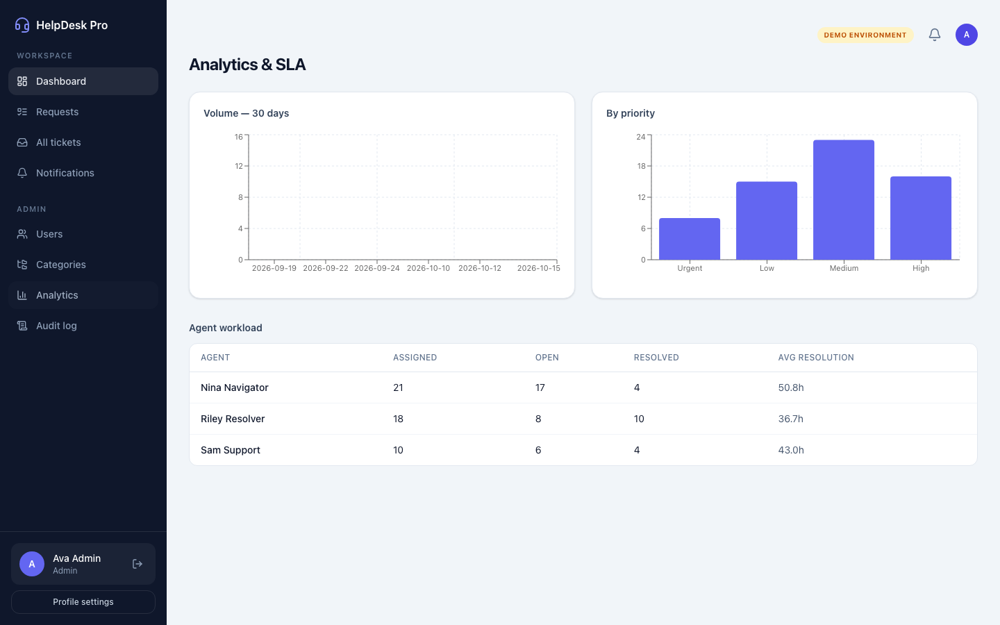

# HelpDesk Pro — Customer Support Platform

[](https://render.com/deploy?repo=https://github.com/Prakash-020/helpdesk-pro)

A production-style, full-stack support ticket system built as a portfolio project.
Customers open tickets, agents triage and resolve them in realtime, admins manage
users, categories, SLA targets and audit logs — with authorization enforced
server-side on every route.

**Live demo walkthrough:** `npm run dev` → open `http://localhost:5173` → one-click
**"Try as Customer / Agent / Admin"** (no signup needed; seeded with 60+ realistic tickets).

| Demo role | Email | Password |
|---|---|---|
| Customer | `customer@helpdesk.dev` | `Demo!Passw0rd` |
| Agent | `agent@helpdesk.dev` | `Demo!Passw0rd` |
| Admin | `admin@helpdesk.dev` | `Demo!Passw0rd` |

## Screenshots

| Landing + one-click demo | Agent queue (priority cards + grouped list) |
|---|---|
|  |  |

| Ticket detail (chat + info panel) | Admin analytics |
|---|---|
|  |  |

---

## Highlights

- **Session auth** — opaque tokens in `HttpOnly` cookies, SHA-256 hashed at rest,
  revocable, sliding renewal. No JWT, nothing in JS-readable storage.
- **RBAC, server-enforced** — `CUSTOMER / AGENT / ADMIN`; scoping happens in the
  query layer. Cross-customer access returns **404** (existence never leaks).
- **Internal notes** — filtered at the DB query *and* masked again in the
  serializer; never emitted over sockets or REST to customers.
- **State machine** — `OPEN → IN_PROGRESS ⇄ WAITING_FOR_CUSTOMER → RESOLVED → CLOSED`
  (+ 14-day reopen). Invalid transitions → `409 FORBIDDEN_TRANSITION`.
- **SLA engine** — per-priority response/resolution targets snapshotted per ticket;
  scheduled sweeper warns assignees once; admin-editable targets.
- **Realtime** — Socket.IO on the same port; handshake auth = the session cookie;
  payloads carry **ids only** (clients refetch over REST — content can't leak).
- **Audit trail** — every sensitive action (status, assignment, roles, category,
  attachments, SLA changes) written transactionally.
- **Search** — `pg_trgm` trigram index on subject for instant fuzzy search.
- **Attachments** — MIME allowlist + size cap, authorized streaming downloads.

## Tech stack

**Web** — React 19, TypeScript (strict), Vite, Tailwind v4, React Router,
TanStack Query, React Hook Form + Zod, Recharts, socket.io-client, Lucide.
**API** — Node 20+, Express, TypeScript strict, Prisma 6, PostgreSQL 16,
bcryptjs, pino-http, Socket.IO, express-rate-limit, helmet, multer, swagger-ui.
**Tooling** — npm workspaces monorepo (`apps/web`, `apps/api`, `packages/shared`),
Vitest + Supertest, React Testing Library, Playwright, ESLint + Prettier, GitHub Actions.

## Architecture

```
Browser (React SPA)
   │  REST /api/v1 + HttpOnly session cookie
   │  WebSocket (same cookie, authorized rooms)
   ▼
apps/api  ──►  Express middleware: helmet → CORS → cookies → session →
   │           rate-limit → origin-check → validated routers
   │  Service layer: role scoping, state machine, transactions, audit
   │  Domain events → in-process bus → Socket.IO room fan-out
   ▼
PostgreSQL 16 (Prisma) · uploads/ on disk in dev (S3 in prod, see docs)
```

`packages/shared` carries wire contracts only: DTO types, enums, Zod schemas,
socket event names — imported by both apps so frontend and backend can never drift.

## Quickstart

```bash
git clone <repo> && cd helpdesk-pro
npm install
cp .env.example apps/api/.env        # set DATABASE_URL + SESSION_SECRET
docker compose up -d postgres        # or point DATABASE_URL at any PG 16
cd apps/api && npx prisma migrate deploy && npm run db:seed && cd ../..
npm run dev:api      # → http://localhost:4000  (REST + Socket.IO + /api/docs)
npm run dev:web      # → http://localhost:5173  (proxied API, HMR)
```

<details><summary>No Docker? (Homebrew Postgres)</summary>

```bash
brew services start postgresql@16
createdb helpdesk && createdb helpdesk_test
```
</details>

## Scripts

| Command | Does |
|---|---|
| `npm run dev:api` / `dev:web` | dev servers with watch |
| `npm test` | Vitest + Supertest (API) + RTL (web) |
| `npm run test:e2e` | Playwright demo flows (servers must be running) |
| `npm run typecheck` | strict TS across all workspaces |
| `npm run build` | production builds |
| `npm run db:seed` | 60-ticket demo dataset (`apps/api`) |
| `cd apps/api && npx prisma migrate reset` | wipe + re-migrate + reseed |

**API docs:** `http://localhost:4000/api/docs` (Swagger UI) · spec at `/api/docs.json`

## Deployment

`docs/deployment.md` covers the full path: Vercel (web) + Render (API) + Neon
(Postgres), the complete env-var contract, a production checklist, and a
Dockerfile (`apps/api/Dockerfile`) for container deploys. Key env vars for the
SPA: `VITE_API_URL` (API origin) + `VITE_SOCKET_URL` (optional, when sockets
can't ride the same host).

## Testing

- `apps/api/tests/` — 17 Supertest cases covering the auth matrix, customer
  isolation, transition matrix, internal-note secrecy, notifications, filters.
  Runs against a dedicated `helpdesk_test` DB with `resetDb()` fixtures.
- `apps/web/src/**.test.tsx` — component + util tests (jsdom).
- `e2e/demo.spec.ts` — Playwright: landing → demo login → role flows → reply.

## Security notes

- Passwords hashed with bcrypt (cost 12); session tokens are opaque + hashed.
- Uniform "Invalid email or password" — no user enumeration; `429` rate limit on
  `/auth/login` + `/auth/register`; `SameSite=Lax` + Origin header check for CSRF.
- Changing role/status revokes the target's sessions immediately.
- Soft deletes (`tickets.deletedAt`) preserve audit integrity; append-only audit log.
- See `docs/decisions.md` for ADRs (session vs JWT, event bus, SLA model…).

## Repo layout

```
apps/web/src        React app — pages/, features/ (tickets, auth), components/, lib/
apps/api/src        modules/ (auth, tickets, categories, users, notifications,
                    attachments, sla, audit, analytics), middleware/, sockets/,
                    events/, jobs/ (sla-sweep), openapi/
packages/shared/src enums, dto, schemas (zod), events (socket contract)
prisma/             schema (9 models), migrations, demo seed
docs/               architecture.md, decisions.md, deployment.md, implementation-status.md, screenshots/
e2e/                Playwright specs        .github/workflows/ci.yml
```

## Roadmap (documented, not stubbed)

Password reset (needs real email delivery) · presigned S3 uploads + AV scan ·
canned responses · email-to-ticket · business-hours SLA · Redis socket adapter
(multi-instance) · SSO/2FA. See `docs/decisions.md` for what's deliberately out
of MVP scope and why.

---

_Built with React, Express, Prisma, PostgreSQL and Socket.IO — designed to be
explained: every architectural choice has an ADR in `docs/decisions.md`._
