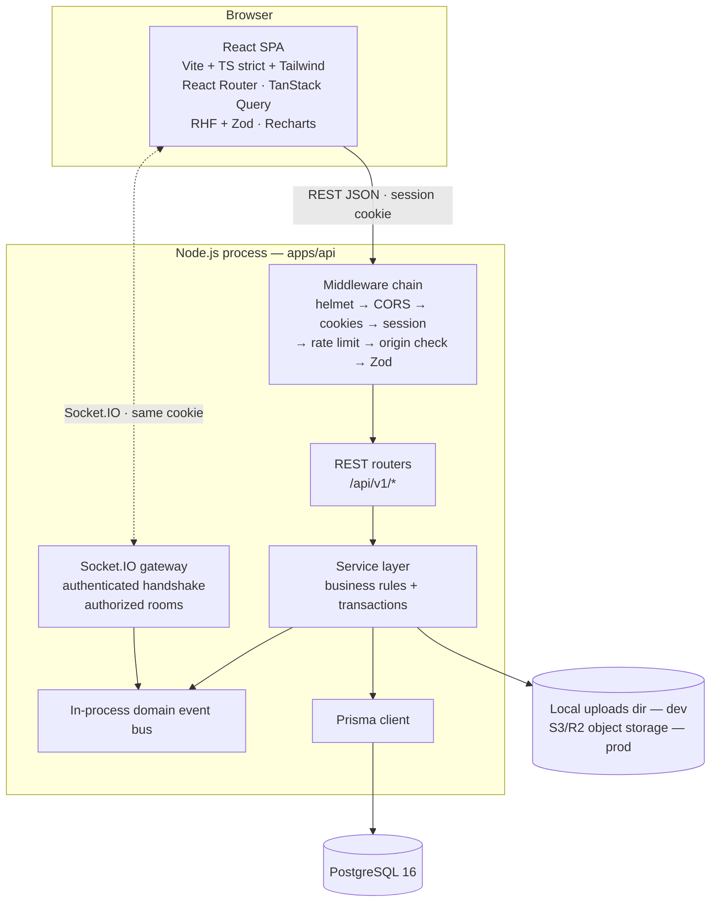
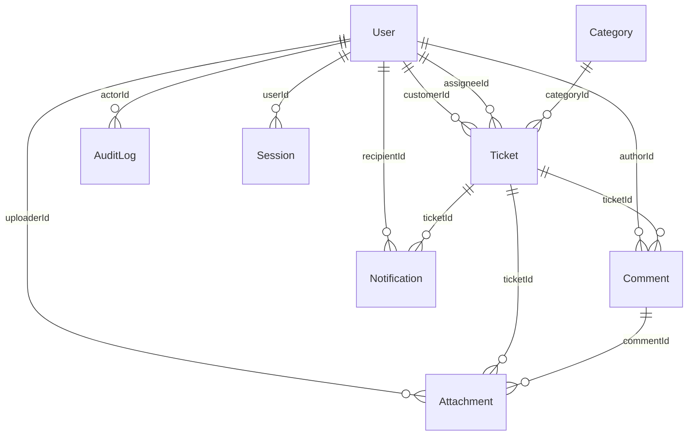
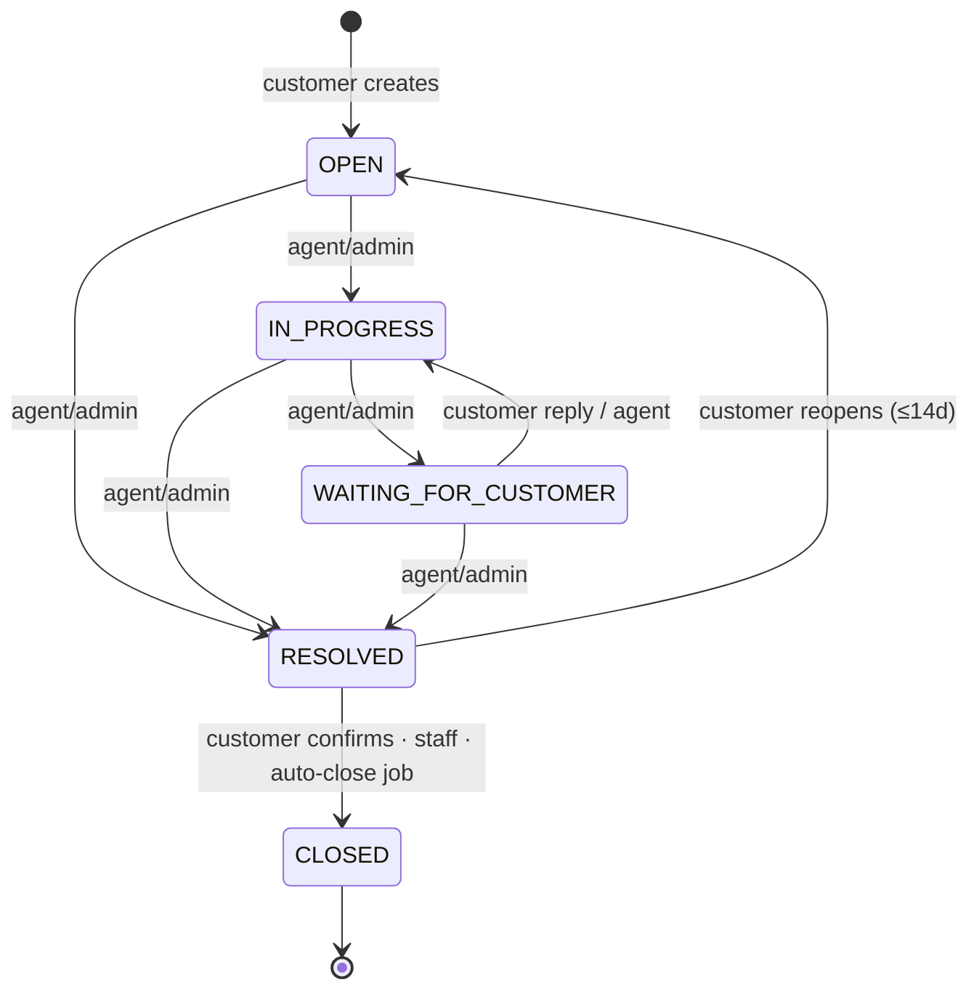

# HelpDesk Pro — Architecture & Planning Specification

Phase 1 deliverable and the project's single source of truth. Supersedes all
earlier drafts. Complements `docs/decisions.md` (ADRs) and
`docs/implementation-status.md` (live project state).

---

## 1. Product Requirements (concise PRD)

**Problem:** support teams need a single place to receive, triage, resolve,
and audit customer issues; customers need visibility into their requests.

**Users:** `CUSTOMER` (reports issues, tracks own tickets), `AGENT` (works
the queue, replies, internal notes), `ADMIN` (users, categories, analytics,
audit, SLA config).

**Core flows:** register/login → create ticket → triage/assign → public
conversation + internal notes → resolve → customer confirms (close) or
reopens. Notifications + realtime updates throughout. Admin dashboards show
workload, SLA, and audit trail.

**Quality goals:** correctness, server-side authorization on every
operation, data integrity via constraints + transactions, testability,
reproducible setup/deploy, interview-ready docs.

**Non-goals (v1):** multi-tenancy, email channel, knowledge base, live chat,
business-hours SLA, mobile apps.

---

## 2. Architecture & Communication Flow

### 2.1 Topology



- **One Node process** serves REST + Socket.IO on the same `http.Server`.
- **REST** for all CRUD; **Socket.IO** only for push notifications of state
  changes. Postgres remains the source of truth; the UI degrades gracefully
  to REST + refetch when sockets disconnect.
- **`@helpdesk/shared`** holds the wire contract only: DTO types, enums,
  Zod request/response schemas, Socket.IO event names + payload types. No
  server-only code ever crosses into the browser bundle.

### 2.2 Request lifecycle (customer creates a ticket)

1. RHF + Zod validates the form → TanStack Query `useMutation` → typed API
   client → `POST /api/v1/tickets` (cookie via `credentials: 'include'`).
2. Middleware chain: `helmet` → CORS allowlist → cookie parser → **session
   middleware** (loads `Session` via hashed token + `User`, attaches
   `req.user`) → login/sensitive-route rate limit → **Origin check (CSRF)**
   → Pino request log → Zod body validation.
3. Service runs a Prisma **transaction**: insert `Ticket` (server-generated
   `ticketNumber` from a Postgres sequence), snapshot SLA due dates,
   `AuditLog` row (`TICKET_CREATED`), `Notification` rows for staff.
4. Service publishes `ticket:created` on the event bus → Socket.IO emits to
   `role:agents`, `role:admins`, `user:{customerId}` → clients invalidate
   TanStack Query keys.
5. `201` + ticket DTO. Errors always `{ error: { code, message, details? } }`.

### 2.3 Realtime channel

- Handshake authenticates via the **same session cookie** (parsed server-side;
  `Origin` verified — SameSite does not cover WebSockets).
- Rooms: `user:{id}` (personal), `role:agents`, `role:admins` (queue),
  `ticket:{id}` — joining a ticket room re-runs the read-authorization check.
- Server→client: `ticket:created`, `ticket:updated`, `ticket:assigned`,
  `comment:created`, `notification:created`, `ticket:sla_warning`.
- Client→server: `ticket:join`, `ticket:leave`.
- `isInternal` comments emit only to staff rooms — never to the customer.
- Event names + payload types live in `@helpdesk/shared`; payload DTOs are
  already-stripped types (no `isInternal` leakage possible by construction).
- Horizontal scaling note: multi-instance needs `@socket.io/redis-adapter` —
  documented post-MVP, not built.

### 2.4 Authentication (server-managed sessions)

- Register/login → Argon2id verify → **fresh** `Session` row per login
  (session-fixation safe: new opaque 256-bit token every login; only its
  SHA-256 hash is stored in `hashedSessionToken`) → cookie `hp_session`:
  `HttpOnly; Secure; SameSite=Lax; Path=/; Max-Age=7d`, sliding renewal.
- Middleware checks `expiresAt`/`revokedAt` + `accountStatus` every request.
- Logout revokes; admin disabling a user revokes all their sessions.
- CSRF: `SameSite=Lax` + `Origin`/`Referer` verification on mutations.
- Password reset deferred — requires real email delivery (documented, not faked).

### 2.5 Dev topology

| Concern | Location | Notes |
|---|---|---|
| web | `http://localhost:5173` | Vite; proxies `/api` + `/socket.io` → `:4000` |
| api | `http://localhost:4000` | `tsx watch`; REST + Socket.IO + Swagger UI |
| PostgreSQL 16 | `localhost:5432` | `docker compose up db`, or local Postgres 16 |

---

## 3. Repository Structure (npm workspaces — per master spec)

```
helpdesk-pro/
├── package.json                  # workspaces + orchestrating scripts
├── package-lock.json
├── tsconfig.base.json            # strict TS shared config
├── .gitignore  .nvmrc  .env.example  .eslintrc / eslint.config.js  .prettierrc
├── docker-compose.yml            # postgres:16 (+ optional adminer)
├── README.md
├── docs/
│   ├── architecture.md           # this file
│   ├── decisions.md              # ADR log
│   ├── implementation-status.md  # live phase/step/test state
│   ├── database.md  api.md  security.md  testing.md  deployment.md
├── scripts/                      # reset-db.sh, seed helpers, verify scripts
├── .github/workflows/ci.yml      # install → lint → typecheck → test → build
├── packages/
│   └── shared/                   # @helpdesk/shared — WIRE CONTRACTS ONLY
│       ├── package.json  tsconfig.json
│       └── src/
│           ├── enums.ts          # Role, TicketStatus, Priority, NotificationType…
│           ├── dto/              # TicketDto, CommentDto, UserDto (pre-stripped)
│           ├── schemas/          # zod request/response schemas (both sides reuse)
│           ├── events.ts         # socket event names + payload types
│           └── index.ts
└── apps/
    ├── api/                      # @helpdesk/api — Express backend
    │   ├── package.json  tsconfig.json
    │   ├── prisma/
    │   │   ├── schema.prisma
    │   │   ├── migrations/       # versioned SQL via `prisma migrate`
    │   │   └── seed.ts           # demo admin/agent/customer + tickets
    │   ├── src/
    │   │   ├── config/           # env validation (zod, fail-fast)
    │   │   ├── middleware/       # session, rbac, validate, errors,
    │   │   │                     # rate-limit, origin-check, pino-http
    │   │   ├── modules/          # auth tickets comments categories users
    │   │   │                     # notifications analytics audit attachments
    │   │   │                     # each: router/controller/service/schemas
    │   │   ├── sockets/          # io setup, handshake auth, room authz, emitters
    │   │   ├── events/           # domain event bus
    │   │   ├── openapi/          # spec builder + swagger-ui mount
    │   │   ├── utils/            # prisma, argon2, logger, pagination
    │   │   ├── app.ts            # express assembly (importable for tests)
    │   │   └── server.ts         # http.Server + io + graceful shutdown
    │   ├── tests/                # vitest + supertest; DB `helpdesk_test`
    │   └── uploads/              # dev-only file storage (gitignored)
    └── web/                      # @helpdesk/web — React SPA
        ├── package.json  tsconfig.json  vite.config.ts  tailwind.config.ts
        ├── index.html
        ├── public/
        ├── e2e/                  # playwright
        └── src/
            ├── main.tsx  App.tsx  index.css
            ├── app/              # providers: QueryClient, Router, Socket ctx
            ├── routes/           # route tree, ProtectedRoute, RoleGuard
            ├── lib/              # typed api client, socket client, formatters
            ├── hooks/
            ├── components/       # AppLayout Sidebar Topbar StatusBadge
            │                     # PriorityBadge Pagination ConfirmDialog
            │                     # EmptyState ErrorState LoadingState…
            ├── features/         # auth tickets comments notifications
            │                     # users analytics admin
            └── test/             # RTL setup + component tests
```

`prisma/` lives in `apps/api/` (spec allows either) so the API is a
self-contained deployable unit — Render builds it with repo-root context.

---

## 4. REST API Contract (`/api/v1`)

```
/auth          POST register · POST login · POST logout · GET me
/tickets       GET (search, status, priority, categoryId, assigneeId,
                    date range, sla, sort allowlist, page/pageSize) · POST
               GET /:id · PATCH /:id
               PATCH /:id/status · PATCH /:id/assignment
               GET /:id/comments · POST /:id/comments
               POST /:id/attachments (multipart)
               GET /:id/attachments/:attachmentId (authorized download)
/categories    GET · POST · PATCH /:id · DELETE /:id
               (in-use → 409 with guidance, or isActive=false — never orphan)
/users         GET · GET /:id · PATCH /:id · PATCH /:id/role · PATCH /:id/status
/notifications GET · PATCH /:id/read · PATCH /read-all
/analytics     GET /overview · GET /tickets · GET /agents   (AGENT sees own
               workload slice; full data ADMIN-only)
/audit-logs    GET (ADMIN, filterable by actor/entity/action/date)
/health        GET   ·   /api-docs  Swagger UI (dev/non-prod)
```

Contracts: list → `{ data, page, pageSize, total }`; error →
`{ error: { code, message, details? } }` with stable codes; `pageSize ≤ 50`;
`sort` allowlisted per endpoint; every mutating route validated by a shared
Zod schema. Reopen = `PATCH /:id/status { status: "OPEN" }` with eligibility
rules — no extra endpoint.

---

## 5. Database Design

### 5.1 ER diagram



### 5.2 Models (brief fields verbatim; * = justified addition)

- **User** — `id`, `name`, `email` (unique, stored lowercase), `passwordHash`,
  `role CUSTOMER|AGENT|ADMIN`, `accountStatus ACTIVE|DISABLED`, timestamps.
- **Session** — `id`, `userId fk→User cascade`, `hashedSessionToken unique`,
  `expiresAt`, `createdAt`, *`revokedAt`*, *`ip`*, *`userAgent`*
  (revocation + audit context).
- **Ticket** — `id`, `ticketNumber unique` (`HD-000123`, Postgres sequence —
  never client-supplied), `subject`, `description`, `status`, `priority`,
  `customerId`, `assigneeId?`, `categoryId`, `firstResponseAt?`,
  `resolvedAt?`, `closedAt?`, `createdAt`, `updatedAt`,
  *`responseDueAt?`*, *`resolutionDueAt?`* (SLA snapshots — needed by
  "filter by deadline" + breach detection), *`deletedAt?`* (soft delete —
  retention policy; audit/history must survive ticket deletion).
- **Category** — `id`, `name unique`, `description`, `isActive`, timestamps.
- **Comment** — `id`, `ticketId fk cascade`, `authorId`, `body`,
  `isInternal`, `createdAt`, `updatedAt`.
- **Attachment** — `id`, `ticketId fk`, `commentId?`, `uploaderId`,
  `originalFilename`, `storageKey` (server-generated UUID key — path
  traversal impossible), `mimeType`, `sizeBytes`, `createdAt`.
- **Notification** — `id`, `recipientId`, `ticketId?`, `type`, `message`,
  `readAt?`, `createdAt`. Persisted — users catch up after being offline.
- **AuditLog** — `id`, `actorId?` (null = system job), `action`,
  `entityType` (TICKET|USER|CATEGORY|COMMENT|SESSION), `entityId`,
  `metadata jsonb` (sanitized diffs only — never passwords/tokens/PII),
  `createdAt`. **Append-only**; no update/delete code paths.
- **SlaTarget** *(minimum model for configurable SLA)* — `id`,
  `priority unique`, `firstResponseMinutes`, `resolutionMinutes`,
  `updatedAt`, `updatedById`.

All timestamps `timestamptz`, stored UTC, rendered client-local. Deletion
policy: categories deactivate instead of deleting when referenced; tickets
soft-delete; sessions purge expired rows via scheduled job; audit retained
24 months.

### 5.3 State machine & transition permissions



| Action | CUSTOMER | AGENT | ADMIN |
|---|---|---|---|
| create ticket | ✅ self | — | — |
| OPEN→IN_PROGRESS, ⇄WAITING_FOR_CUSTOMER, →RESOLVED | — | ✅ | ✅ |
| RESOLVED→CLOSED | ✅ own | ✅ | ✅ |
| RESOLVED→OPEN (reopen window) | ✅ own | ✅ | ✅ |
| assign / priority / internal note / edit ticket | — | ✅ | ✅ |
| queue visibility | own tickets only | unassigned + assigned-to-me | all |

Illegal transition → `409 FORBIDDEN_TRANSITION`. Every transition +
assignment writes `AuditLog` inside the same transaction.

### 5.4 Indexes — each maps to a named query

| Table | Index | Serves |
|---|---|---|
| Ticket | `unique(ticketNumber)` | public lookup/display |
| Ticket | `(status, priority, createdAt desc)` | agent queue default sort |
| Ticket | `(assigneeId, status)` | "my tickets" |
| Ticket | `(customerId, createdAt desc)` | customer portal |
| Ticket | `(categoryId)`, `(createdAt desc)` | filters + volume analytics |
| Ticket | GIN `pg_trgm(subject)` | `?search=` substring search |
| Comment | `(ticketId, createdAt)` | conversation thread |
| Notification | partial `(recipientId, createdAt desc) WHERE readAt IS NULL` | unread badge |
| Notification | `(recipientId, createdAt desc)` | notifications page |
| AuditLog | `(entityType, entityId, createdAt)` | entity history |
| AuditLog | `(actorId, createdAt)` | per-user activity |
| Session | `unique(hashedSessionToken)`, `(userId)`, `(expiresAt)` | auth lookup, revoke-all, purge |
| Attachment | `(ticketId)`, `(commentId)` | file lists |
| User | `unique(email)`, `(role)` | login, admin filters |

Postgres never auto-indexes FKs — all are explicit `@@index`. Composite
keys order equality→range. `firstResponseAt`/`resolvedAt` are stored
timestamps so analytics are `AVG()` over intervals, not audit replay.

---

## 6. Security Model

Argon2id hashing · opaque tokens hashed at rest · `HttpOnly;Secure;SameSite`
cookies · session expiry + revocation + fresh token per login (fixation) ·
login/sensitive-endpoint rate limits · Zod on every boundary · Prisma
parameterized queries · CORS allowlist · helmet headers · upload size/MIME
allowlist + server-side keys + authorized downloads only · IDOR prevention
via service-layer ownership checks · `isInternal` filtered in query AND
serializer · secrets via env only · Pino logging with redact paths for
password/cookie/token fields · account-status enforcement on every request.
Remaining risks documented in `docs/security.md` — no "completely secure"
claims.

## 7. MVP vs. Advanced

| MVP (finish first) | Advanced (post-MVP) |
|---|---|
| Session auth + 3-role RBAC, profile update | Password reset (needs email), OAuth, 2FA |
| Full ticket lifecycle, assignment, search/filter/sort/paginate | Bulk ops, merging, automation rules |
| Public comments + internal notes + audit trail | Rich text, canned responses |
| Persisted notifications + Socket.IO live updates | Email digests, presence, typing |
| Attachments (local dev / S3 prod) w/ authorized download | AV scanning, presigned direct upload |
| Analytics: stat cards + Recharts (real queries) | Custom reports, exports, CSAT |
| SLA: per-priority targets, due dates, breach flag — **calendar time** | Business-hours calendars, escalations |
| Vitest+Supertest+RTL+Playwright, CI, Swagger | Coverage gates, load tests, Sentry |
| Vercel + Render + managed PG deploy | Redis socket adapter, multi-instance |

## 8. Implementation Roadmap (14 phases, testable milestones)

| # | Phase | Milestone (must be verified, not assumed) |
|---|---|---|
| 1 | Architecture & planning ✅ | This doc + decisions + status committed |
| 2 | Repository & environment | `npm run dev` boots web+api; `/api/health`→200; env validation fails fast on bad env |
| 3 | Database foundation | `migrate dev` clean on fresh DB; indexes verified (`\d+`); seed idempotent with demo accounts |
| 4 | Backend foundation | Error contract proven; request id in logs; Swagger UI serves spec; validation rejects bad input |
| 5 | Auth & authorization | Register/login/logout/me e2e; wrong-role→403; expired/revoked→401; permission-matrix tests green |
| 6 | Core tickets | Full transition matrix tested; customer isolation proven; filters/pagination/sort verified |
| 7 | Conversations | Internal note invisible to customer (tested); thread + attachments authorized; notifications persisted |
| 8 | Frontend foundation | Shell + routing + api client + auth forms; role-aware nav; expired-session → login redirect |
| 9 | Customer & agent workflows | Create→reply→resolve→close clickable for all roles; queue + assign controls work |
| 10 | Administration | User/category mgmt; dashboards render real data; audit log page filterable |
| 11 | Advanced features | Two-browser live update; SLA breach flagged; attachment round-trip in UI |
| 12 | QA | CI green: lint+typecheck+vitest+build; Playwright core flows; negative authz matrix passes |
| 13 | Deployment | Deployed URL passes demo script; `migrate deploy` applied; cookies/CORS verified prod-correct |
| 14 | Portfolio delivery | README + diagrams + screenshots + demo script + interview Q&A; fresh-clone setup <15 min |

## 9. Deployment Plan

`apps/web`→Vercel · `apps/api`→Render web service (long-lived Node required —
Vercel serverless can't hold Socket.IO) · managed Postgres (Neon/Render) ·
uploads→S3/R2 (local disk dev). Cookies: prefer Vercel rewrite `/api/*`→Render
(`SameSite=Lax`); fallback `SameSite=None;Secure`. `prisma migrate deploy` as
release step — never `db push`, never `migrate reset` in deploy. GH Actions:
Postgres service container → migrate → test → build.
